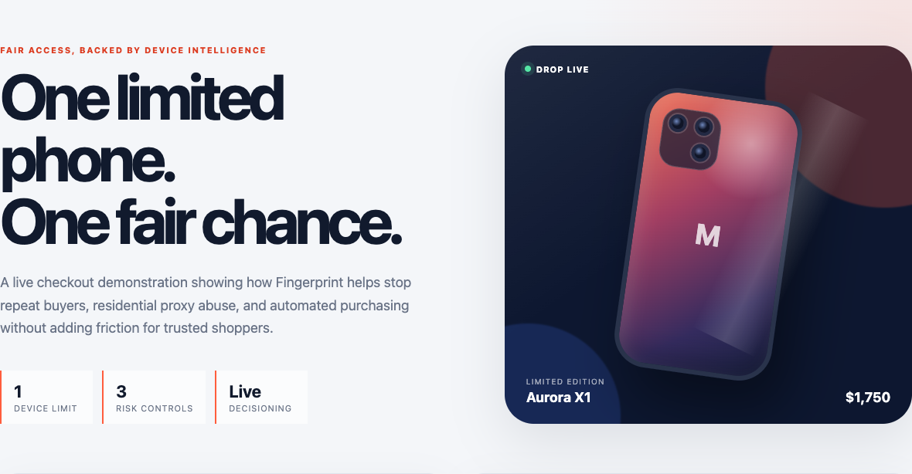
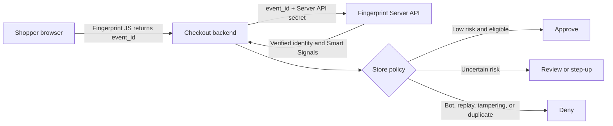
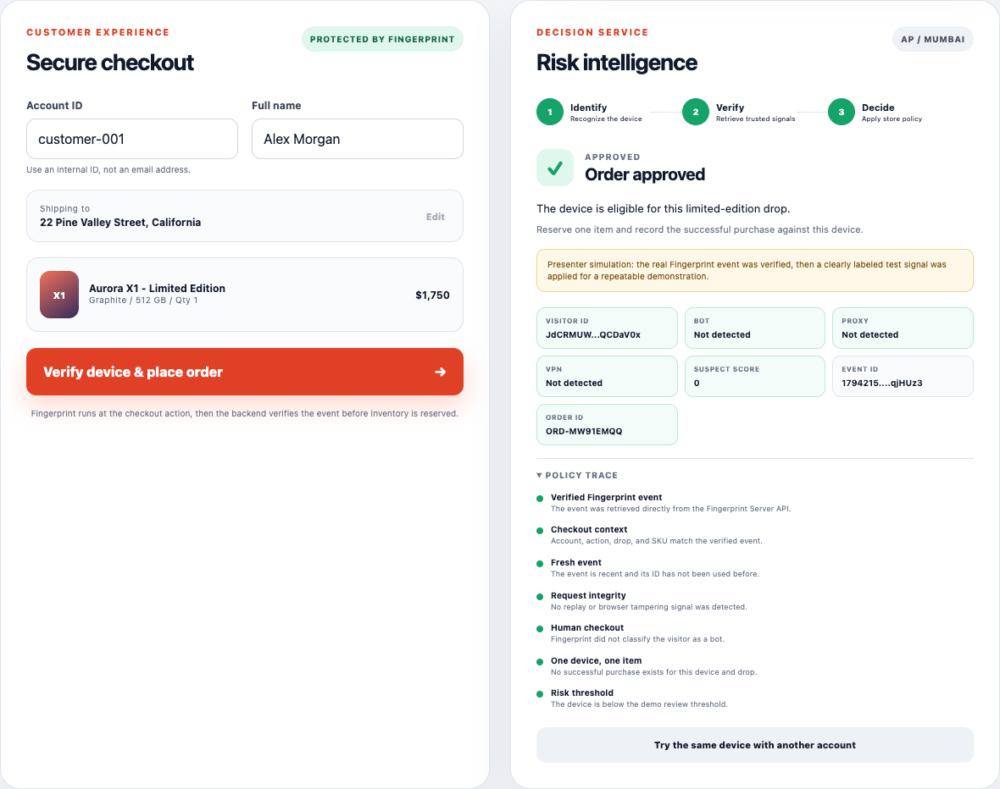
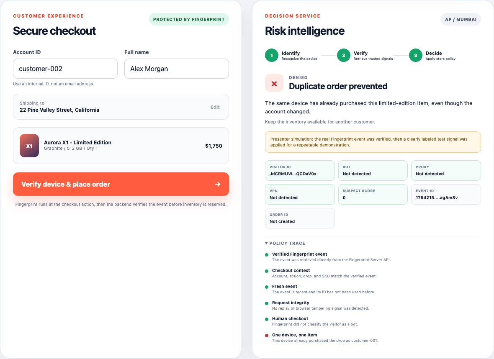

<div align="center">

# Fingerprint Fair-Drop Checkout Demo

**A server-verified device intelligence demo for protecting limited inventory.**


</div>



## Overview

The Mobile Store is releasing a limited-edition phone with a one-item-per-customer policy. Account and IP checks alone are easy to evade: a repeat buyer can create another account, change networks, use a residential proxy, or automate checkout.

This project demonstrates how a checkout backend can use Fingerprint to:

- Recognize the same device across different store accounts.
- Verify the browser event through the Fingerprint Server API before reserving inventory.
- Block automated checkout attempts.
- Route proxy, VPN, and elevated-risk traffic to step-up verification.
- Enforce one successful device purchase per product drop.
- Explain every decision through a visible policy trace.

> [!IMPORTANT]
> A Visitor ID represents device/browser intelligence. It is not proof of a unique person. A production policy should combine it with account, payment, shipping, household, and exception-handling rules.

## Architecture



The browser sends only the Fingerprint event ID with the checkout request. The backend retrieves the verified event and checks its account, action, drop, SKU, timestamp, single-use status, identity, and risk signals.

## Prerequisites

- [Node.js](https://nodejs.org/) 20 or newer.
- Internet access for Fingerprint JS and the Server API.
- A Fingerprint public key and Server API secret key from the same workspace.
- An Asia-region Fingerprint workspace for the included configuration.

## Quick start

```bash
cd fingerprint-mobile-store-demo
npm ci
npm run check
npm start
```

When prompted, paste the **Server API secret key** and press Enter. Terminal input is hidden, and the key stays only in the running process memory.

Open [http://localhost:8081](http://localhost:8081).

### Configuration

| Setting | Current value | Location |
|---|---:|---|
| Fingerprint public key | Included for the demo | `public/app.js` |
| Browser region | `ap` | `public/app.js` |
| Server API region | `ap` by default | `FINGERPRINT_REGION` environment variable |
| Server API secret | Requested securely at startup | Never committed |
| Local port | `8081` | `PORT` environment variable |

The public key is intentionally visible in browser code. The Server API secret must remain server-side and must never be committed to GitHub.

If you use another Fingerprint workspace, update the public key and browser region in `public/app.js`, then start the backend with the matching Server API secret and region.

## Demo scenarios

The scenario selector makes the presentation repeatable. Every scenario first generates and verifies a real Fingerprint event. The selected presenter scenario then applies a clearly labeled test signal before the store policy runs.

| # | Scenario | How to run it | Expected outcome |
|---:|---|---|---|
| 1 | Trusted first purchase | Click **Reset demo data**, select **Simulate trusted baseline**, and submit `customer-001`. | **Approve** and create an order. |
| 2 | New account, same device | After approval, click **Try the same device with another account** and submit again. | **Deny** because that Visitor ID already purchased the drop. |
| 3 | Residential proxy | Reset, select **Simulate residential proxy**, and submit. | **Review** with step-up verification instead of an automatic block. |
| 4 | Bad bot | Reset, select **Simulate bad bot**, and submit. | **Deny** before inventory is reserved. |
| 5 | Live signals | Reset, select **Live Fingerprint signals**, and submit. | Use the unmodified signals returned for the current browser and network. |

### Recommended live presentation sequence

1. Start with the trusted purchase and point out the verified Visitor ID and policy trace.
2. Change only the account and show that the device remains the same.
3. Reset and demonstrate why a residential proxy creates friction rather than an immediate rejection.
4. Reset and show the automated checkout denial.
5. Use **Live Fingerprint signals** only as an optional follow-up because its outcome depends on the current device and network.

### Expected results

<table>
  <tr>
    <td width="50%"></td>
    <td width="50%"></td>
  </tr>
  <tr>
    <td align="center"><strong>First eligible purchase: approved</strong></td>
    <td align="center"><strong>Another account on the same device: denied</strong></td>
  </tr>
</table>

## Decision policy

The backend evaluates checkout attempts in this order:

1. Retrieve the event from the Fingerprint Server API.
2. Confirm that the verified event matches the account, checkout action, product drop, and SKU.
3. Reject an event outside the two-minute checkout window or an event ID already used.
4. Reject replay and browser-tampering signals.
5. Reject bot traffic from transactional checkout.
6. Reject another successful purchase from the same Visitor ID for the same drop.
7. Route proxy, VPN, high-activity, or elevated-risk traffic to review.
8. Approve and record a clean, eligible device.

## Security choices

- The Server API secret never enters browser code or API responses.
- The default startup flow asks for the secret with hidden terminal input.
- The backend retrieves trusted event data instead of accepting risk claims from the browser.
- Event IDs are single-use and must match the checkout context.
- API responses use `Cache-Control: no-store`.
- Complete server-side signal objects are not exposed to the browser.
- Presentation simulations are disabled when `NODE_ENV=production`.

## Project structure

```text
fingerprint-mobile-store-demo/
├── docs/
│   └── images/          README screenshots
├── public/
│   ├── app.js           Fingerprint browser integration and demo controls
│   ├── index.html       Checkout and decision-service interface
│   └── style.css        Responsive presentation styling
├── .gitignore           Secrets, dependencies, and presentations excluded
├── .nvmrc               Recommended Node.js major version
├── package-lock.json    Reproducible dependency versions
├── package.json         Scripts and runtime dependency
├── README.md
└── server.js            Server API verification and decision policy
```

## Useful commands

```bash
# Validate JavaScript syntax
npm run check

# Start on another port
PORT=8090 npm start

# Explicitly select the Asia region
FINGERPRINT_REGION=ap npm start

# Install exactly the locked dependency versions
npm ci
```

## Troubleshooting

| Problem | What to check |
|---|---|
| Fingerprint returns `403` | Confirm the public and secret keys belong to the same workspace and that the server region is `ap`. |
| The browser agent does not load | Allow Fingerprint on localhost, disable an aggressive ad blocker, and confirm internet access. |
| Port `8081` is already in use | Run `PORT=8090 npm start` and open the new port. |
| A scenario gives an unexpected duplicate result | Click **Reset demo data** before starting that scenario. |
| Startup cannot request the secret interactively | Set `FINGERPRINT_SECRET_KEY` in the process environment for that run. Do not save it in the repository. |

## Demo boundaries

Purchase history, replay state, and recent attempts are stored in memory for a portable demonstration. Restarting the server or clicking **Reset demo data** clears them.

A production implementation should use a durable shared store, idempotent order writes, stronger collection through a custom subdomain or proxy integration, monitoring, privacy controls, and a defined exception path for shared or replaced devices.

---

<div align="center">
  Built by <strong>Akash Singh</strong> for a Fingerprint demonstration.
</div>

